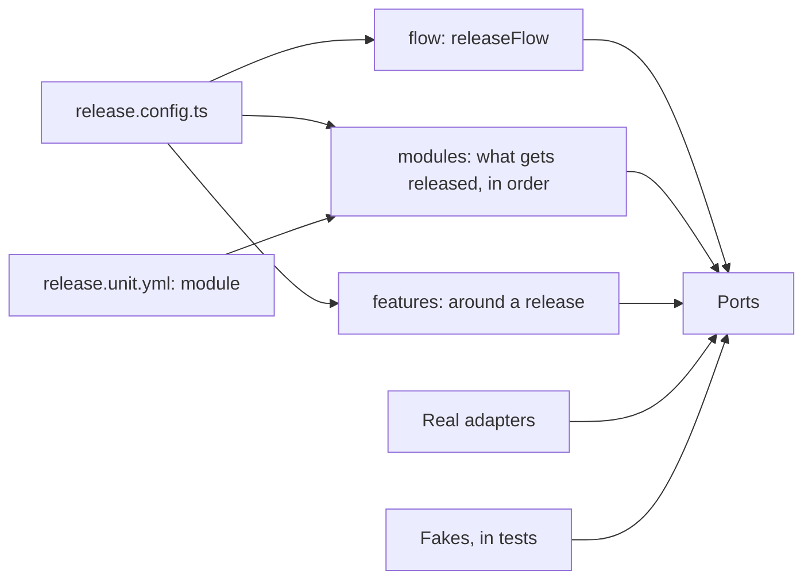

# ADR-009: The release CLI composes modules, each given the providers it needs through a port

## Status

Accepted. Supersedes the "plugins composed in code" and "`target:`" parts of ADR-006; the rest of
ADR-006 (TypeScript, hexagonal layers, jobs as data, one YAML file per app, fire and forget) stands.

## Context

`release.config.ts` is one flat `plugins: [...]` list that mixes three different things:

- **Providers of the core ports**: `git()` gives `SourceControl`, `github()` gives `CodeHost`,
  `changesets()` gives `Versioning`. Each `provides` into one global `Services` bag.
- **Deploy targets**: `fly()`, `cloudflarePages()`, `eas()`, `npm()`, `releaseOnly()`, which each
  app picks by vendor name in its `release.unit.yml` (`target: eas`).
- **Features**: `releaseComments()`, which reads whatever it needs from the global bag.

So the config reads as a list of vendors, a feature's dependencies are invisible, and an app names
its vendor instead of what it is. Swapping Fly for another host means touching every app that names
it.

One `TargetPlugin` interface also serves every kind of app. Its optional hooks are used very
unevenly:

| Provider         | Hooks it implements                                                                                              |
| ---------------- | ---------------------------------------------------------------------------------------------------------------- |
| eas              | decide, beforeVersion, inspect, health, detect, questions, requirements, versionFiles, decidedBy, typicalMinutes |
| fly              | detect, questions, requirements, typicalMinutes                                                                  |
| cloudflare-pages | detect, questions, requirements, typicalMinutes                                                                  |
| npm              | decide, detect, requirements                                                                                     |
| release-only     | decide, releaseOnly                                                                                              |

Mobile ideas (store build or over-the-air update, runtime version, crash health) live on an
interface a static site also implements. A generic deploy port is the lowest common denominator.

## Decision

The config has three parts. The **flow** is how the release itself runs, **modules** are what gets
released, in order, and **features** happen around a release. Each expects **ports**, and the config
gives it an **adapter** for each. Apps name their module in their own `release.unit.yml`, never a
vendor.



### The configuration

```ts
// release.config.ts
const sourceControl = gitSourceControl({
  format: ["pnpm", "exec", "prettier", "--write", "--ignore-unknown", "--log-level=warn"],
});
const codeHost = gitHubCodeHost();

export default defineRelease({
  // How the release itself runs: versions, tags, release PR, GitHub releases, CI.
  flow: releaseFlow({
    sourceControl,
    codeHost,
    ciPipeline: gitHubActionsCiPipeline(),
    versioning: changesetsVersioning({ version: ["pnpm", "-s", "changeset:version"] }),
  }),
  // What gets released, in this order. The first app is the repository's Latest release.
  modules: [
    mobileApp({ mobileDistribution: easMobileDistribution() }), // 1 expo · Latest
    backendService({ serverHosting: flyServerHosting() }), // 2 api
    webApp({ staticHosting: cloudflarePagesStaticHosting() }), // 3 admin, 4 landing
    internalTool(), // 5 release
  ],
  // What happens around a release, after the ship.
  features: [releaseComments({ codeHost, sourceControl })],
  display: { verbose: true, mascot: true },
});
```

```yaml
# apps/expo/release.unit.yml
module: mobile-app
update:
  preview: eas:update:preview
  production: eas:update:production:gated
```

- `flow`, `modules` and `features` take three distinct types (`ReleaseFlow`, `ReleaseModule`,
  `Feature`), so `modules: [releaseComments(...)]` does not compile. `latest` is gone.
- An app's `release.unit.yml` replaces `target:` with a reserved `module:` key; the rest of the file
  is validated by the adapter its module holds, and the editor schema switches on `module:`. The
  config lists no apps. A module's name defaults to its kind and can be set when two modules of the
  same kind use different providers: `backendService({ name: "workers", serverHosting: ... })`, then
  `module: workers`.
- Loading fails, with the known names, on an unknown module (with "did you mean"), two modules
  sharing a name, a leftover `plugins` or `target:`, or an adapter setting named `module`. A module
  no app names is a `doctor` warning.

### The order of `modules` is the release order

Like a semantic-release plugin pipeline, the array order drives everything done per app: versions in
the release PR, tags, GitHub releases, deploys, health checks and comments.

- Inside a module with several apps, apps go alphabetically by name.
- The first app is the repository's Latest release on GitHub; when it is not part of a release, the
  badge does not move (as `latest: "expo"` behaved).
- An app referencing another app's URL (`${units.api.url}`) must come after it, or loading fails
  naming the module to move.
- `release plan` and `doctor` print the numbered order, so a reorder shows before anything ships.
- Features run after the ship, in their own array order.

### Ports and adapters

A port is named after what it does, with the `Port` suffix used across the repo. An adapter is
`<Provider><Port>Adapter`, built by a factory named the same way.

| Port                     | What it does                                                  | Adapter                                                | Factory                                      |
| ------------------------ | ------------------------------------------------------------- | ------------------------------------------------------ | -------------------------------------------- |
| `SourceControlPort`      | Commits, tags, branches, diffs                                | `GitSourceControlAdapter`                              | `gitSourceControl()`                         |
| `CodeHostPort`           | Pull requests, comments, releases, deploy records             | `GitHubCodeHostAdapter`                                | `gitHubCodeHost()`                           |
| `CiPipelinePort`         | Dispatch a workflow, read its runs, the minutes budget        | `GitHubActionsCiPipelineAdapter`                       | `gitHubActionsCiPipeline()`                  |
| `VersioningPort`         | Pending changes, bumps, changelogs                            | `ChangesetsVersioningAdapter`                          | `changesetsVersioning()`                     |
| `ServerHostingPort`      | Deploy a server, its health                                   | `FlyServerHostingAdapter`, `ShellServerHostingAdapter` | `flyServerHosting()`, `shellServerHosting()` |
| `StaticHostingPort`      | Deploy a static site                                          | `CloudflarePagesStaticHostingAdapter`                  | `cloudflarePagesStaticHosting()`             |
| `MobileDistributionPort` | Store build or update, runtime version, rollout, crash health | `EasMobileDistributionAdapter`                         | `easMobileDistribution()`                    |
| `PackageRegistryPort`    | Publish a package                                             | `NpmPackageRegistryAdapter`                            | `npmPackageRegistry()`                       |

- **`CiPipelinePort` is split from `CodeHostPort`** (interface segregation): code on GitHub with CI
  elsewhere is a common setup. Deploy records stay on the code host.
- **Each port carries only what its kind of delivery does**: the build or update decision, the
  runtime version and crash health live on `MobileDistributionPort`, not on a port a static site
  also implements.
- **Every adapter is a recipe**, not a live object:
  `{ name, settings, detect, questions, requirements, create({ root, shell }) }`. Loading and
  `release init` read its settings schema, `detect` and `questions` before anything is created; the
  CLI calls `create` when a module runs, and reloading the config creates fresh ports.
  `requirements` feed `doctor`.
- A new provider is a new adapter for an existing port: `GitLabCodeHostAdapter`,
  `RenderServerHostingAdapter`, `NetlifyStaticHostingAdapter`.

### Modules and features

A module's (or feature's) parameters are the ports it expects, each named after its port, never a
vague name such as `hosting`. TypeScript checks the fit:
`mobileApp({ mobileDistribution: flyServerHosting() })` does not compile. Every stage is optional:
`requirements`, `version`, `decide`, `ship`, `afterShip`, `health`, `inspect`; the flow owns their
order.

| Where      | Name               | In `release.unit.yml` | Ports it expects                                        |
| ---------- | ------------------ | --------------------- | ------------------------------------------------------- |
| `flow`     | `releaseFlow`      | (the release itself)  | `sourceControl`, `codeHost`, `ciPipeline`, `versioning` |
| `modules`  | `backendService`   | `backend-service`     | `serverHosting`                                         |
| `modules`  | `webApp`           | `web-app`             | `staticHosting`                                         |
| `modules`  | `mobileApp`        | `mobile-app`          | `mobileDistribution`                                    |
| `modules`  | `publishedPackage` | `published-package`   | `packageRegistry`                                       |
| `modules`  | `internalTool`     | `internal-tool`       | none (versioned and tagged, never deployed)             |
| `features` | `releaseComments`  | (claims no app)       | `codeHost`, `sourceControl`                             |

### Testing, by level of the trophy

Every port has **one Fake**, test-only, in `src/adapters/<port>/__fakes__/<port>.fake.ts`: in-memory
state, `seed()` to prime it, and a record of what it received. Tests assert on that record, so a
Fake needs no `vi.fn()` spies; "not called" is an empty record. This replaces the repo's two-layer
InMemory + Fake rule for the release CLI. Each port also has a shared contract suite
(`<port>.contract.ts`) run on its Fake and its real adapters, which keeps the Fake honest.

| Level       | What it covers                                                                  | With                                                                                                                                |
| ----------- | ------------------------------------------------------------------------------- | ----------------------------------------------------------------------------------------------------------------------------------- |
| Static      | A module given the wrong port, a missing port, unused code                      | TypeScript, ESLint, knip, a type test with `@ts-expect-error`                                                                       |
| Unit        | Pure rules: previous tag, linked issues, version order, the mobile build policy | Plain functions, no adapter                                                                                                         |
| Contract    | Every real adapter behaves like its Fake                                        | One suite per port, on the Fake and real git (temp repo) always; GitHub, Actions and changesets with `RELEASE_CONTRACT_LIVE=1` only |
| Integration | Modules, features and use cases together                                        | A Fake for every port; most tests live here                                                                                         |
| End to end  | The CLI's real entry, as a person runs it                                       | `release plan` on this repository (read only, hashes masked), and a rehearsal on Fakes through ship to preview and promote          |

### Files

```
src/domain/                                                 pure rules
src/ports/code-host.port.ts                                 CodeHostPort
src/adapters/code-host/github-code-host.adapter.ts          GitHubCodeHostAdapter, gitHubCodeHost()
src/adapters/code-host/__fakes__/code-host.fake.ts          CodeHostFake, codeHostFake()
src/adapters/code-host/code-host.contract.ts                the shared contract suite
src/modules/mobile-app/mobile-app.module.ts                 mobileApp()
src/features/release-comments/release-comments.feature.ts   releaseComments()
src/application/                                            the release flow and its use cases
src/cli/
```

## Consequences

- Swapping a provider is one argument in `release.config.ts`, plus that provider's own keys in the
  app files it serves: an EAS setting means nothing to another mobile provider.
- A module's dependencies are visible where it is composed, and its tests give it Fakes of exactly
  those ports. The contract suites keep the Fakes honest.
- The order of `modules` carries meaning, a known convention (semantic-release, Vite, Express); the
  numbered `plan` output and the reference-order check keep a reorder from going unnoticed.
- The config is a breaking change: `plugins`, `target:` and `latest` are refused with a message
  naming the new keys. `release init`, `release add` and `release adapter new` write the new shape;
  a scaffolded adapter comes with its Fake and the port's contract suite wired to it.
- Output stays the same: the release PR, `status --json` and `plan` still name the provider.
- Delivered in five stacked steps, each leaving `release plan` on this repository unchanged:
  1. Capability ports (this ADR).
  2. The module contract and the release flow calling modules.
  3. Port names and the `CiPipelinePort` split; a Fake and a contract suite for every port.
  4. Adapters as recipes; `flow`, `modules` and `features`; the order rule; `module:` in the unit
     files; init and scaffolding; the rehearsal end-to-end test.
  5. Folders as above, docs and `TESTING.md`.
