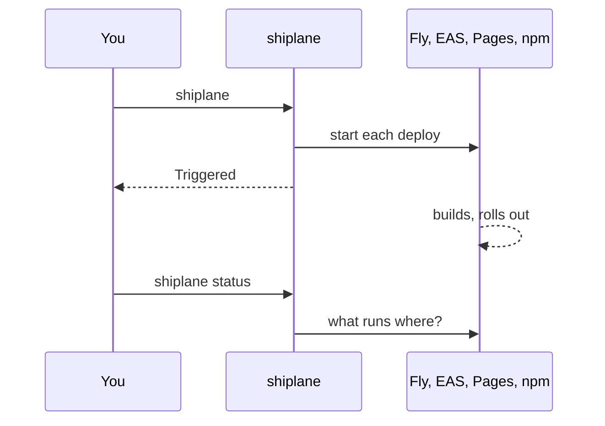
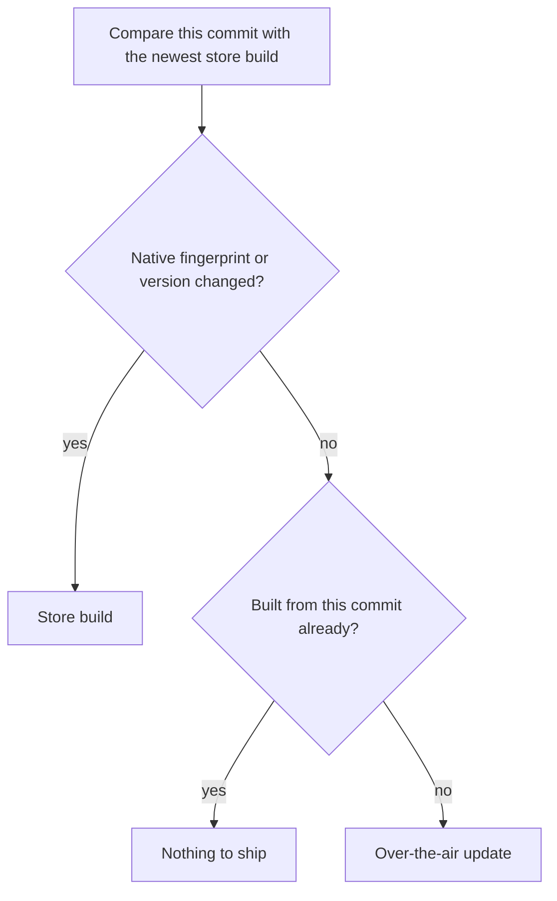

[🏠 Home](../../README.md) · [📚 Docs](../README.md) ·
[`shiplane`](../../packages/shiplane/README.md) · [🚀 Tutorial](./tutorial.md) ·
[🛠️ How-to](./how-to.md) · [📖 Reference](./reference.md) · [🔌 Plugins](./plugins.md) · **💡
Explanation**

# 💡 Explanation

## A ship triggers each deploy and returns

A deploy finishes on its own platform, in minutes nobody can act on. So shiplane starts it and
returns; `shiplane status` reads the outcome later, from any machine. It waits only for what is a
decision (your merge) or what it must confirm before recording it (a Fly rollout).

## The core holds the release, plugins hold the hosts

The core knows what changed, versions, tags, order and safety. Each host is a plugin filling a port,
so a repository installs only what it ships with, and a new host is a new package, not a new CLI.
One plugin per provider, not per port: GitHub's code host, Actions and comments share one sign-in.
The shell adapter stays built in, the fallback for any host.

## The order of `modules` is the release order

Versions, tags, deploys and comments follow it, so `plan` shows a reorder before anything ships. An
app reading another's url comes after it, and loading says so when it does not.

## Changesets decide what ships

A diff says something changed; a changeset says whether it is a fix or a feature, and what to tell
users. So it drives the version and the changelog, and a change with none stays unreleased.

Core only knows the versioning port, so where changesets come from is the adapter's choice:
`commitsVersioning()` writes them from Conventional Commits and hands them to changesets, with
nothing in core reading a commit to release it.

A changeset is written before anyone sees the whole release, so whoever releases has the last word:
the computed version is selected, and picking another takes a typed line. It is typed, not picked
from a list, because a list only repeats what the number says, major means breaking, while users
need to know what broke. Going up adds a changeset, so the changes keep the sections they were
written for. Going down caps every line, since a single minor left in a fixed group would hold the
whole group up.

## A package or a plugin has no environment

Preview and production are places an app runs. A package goes straight to its registry, and a plugin
ships when its release PR merges, so neither stops anywhere on the way to its users. A run says
`live` for them, and `preview` only when something released with them does deploy there.

## What runs where is read from the platform

GitHub Deployments records each deploy under its tag, so every machine knows what preview and
production run without a local file. npm and EAS know their own state, so their plugins read it
there instead.

## A mobile app takes an update unless its native layer changed

An over-the-air update only reaches binaries built from the same native layer and version.

One update reaches both platforms, so the stricter verdict wins. A new binary needs a new version,
which is why production first opens a PR moving its version to the one preview validated.

## CI and your laptop run the same jobs

Through GitHub Actions, shiplane dispatches one workflow, `ship.yml`, which runs `shiplane ship` on
the runner. Same jobs, same unit files: a url changed once reaches both paths.

## Production makes you type its name

It reaches every user, so it cannot start by reflex or by `--yes`.

## Fakes keep the tests honest

Every port has a Fake and a contract suite. The suite runs on the Fake and on each real adapter, so
a test passing on Fakes says something true about the real hosts.
