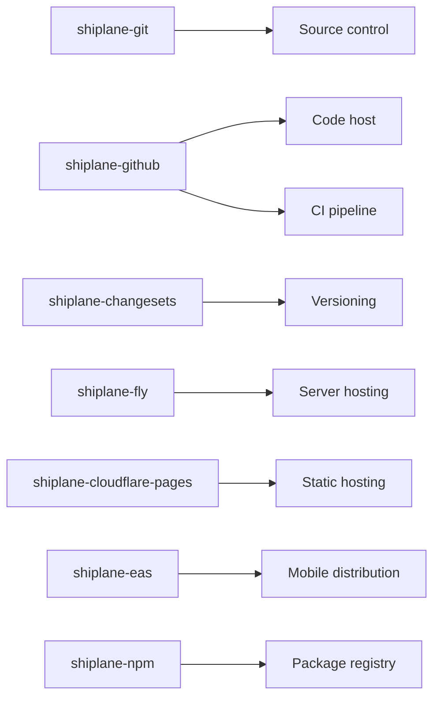

[🏠 Home](../../README.md) · [📚 Docs](../README.md) ·
[`shiplane`](../../packages/shiplane/README.md) · [🚀 Tutorial](./tutorial.md) ·
[🛠️ How-to](./how-to.md) · [📖 Reference](./reference.md) · **🔌 Plugins** ·
[💡 Explanation](./explanation.md)

# 🔌 Plugins

The adapters you can inject into the core. Each plugin is its own package: install it, call its
factory in `shiplane.config.ts`, and it fills one port.



## Adapters

| Package                                                                         | Factory                                         | Port                | Goes in            |
| ------------------------------------------------------------------------------- | ----------------------------------------------- | ------------------- | ------------------ |
| [shiplane-git](../../packages/shiplane-git/README.md)                           | `gitSourceControl()`                            | Source control      | `releaseFlow`      |
| [shiplane-github](../../packages/shiplane-github/README.md)                     | `gitHubCodeHost()`                              | Code host           | `releaseFlow`      |
| [shiplane-github](../../packages/shiplane-github/README.md)                     | `gitHubActionsCiPipeline()`                     | CI pipeline         | `releaseFlow`      |
| [shiplane-changesets](../../packages/shiplane-changesets/README.md)             | `changesetsVersioning()`, `commitsVersioning()` | Versioning          | `releaseFlow`      |
| [shiplane-fly](../../packages/shiplane-fly/README.md)                           | `flyServerHosting()`                            | Server hosting      | `backendService`   |
| [shiplane-cloudflare-pages](../../packages/shiplane-cloudflare-pages/README.md) | `cloudflarePagesStaticHosting()`                | Static hosting      | `webApp`           |
| [shiplane-eas](../../packages/shiplane-eas/README.md)                           | `easMobileDistribution()`                       | Mobile distribution | `mobileApp`        |
| [shiplane-npm](../../packages/shiplane-npm/README.md)                           | `npmPackageRegistry()`                          | Package registry    | `publishedPackage` |

`shiplane-github` also brings a feature, `releaseComments()`, for `features`. Each package's README
has its unit file keys, an example and the sign-ins it needs. Each plugin is installed as
`@shiplane/<name>`.

## Built in: `shellServerHosting()`

From `shiplane` itself, for a host with no adapter yet.

| Key      | Default  | Means                                                 |
| -------- | -------- | ----------------------------------------------------- |
| `deploy` | required | The command that ships it, as a list, per environment |
| `url`    |          | Where it answers, for other units to read             |

Source: `src/adapters/server-hosting/shell-server-hosting.adapter.ts`.

## Write a plugin

A plugin exports factories built with `shiplane/plugin`. From
[`examples/render-server-hosting.ts`](../../packages/shiplane/examples/render-server-hosting.ts):

```ts
import { defineServerHosting, z } from "shiplane/plugin";

export const renderServerHosting = () =>
  defineServerHosting({
    name: "render",
    settings: z.object({ service: z.string().describe("The Render service") }),
    describe: ({ options }) => `${options.service} on Render`,
    requirements: () => [
      {
        label: "render",
        check: { command: "render", args: ["whoami"] },
        fix: { command: "render", args: ["login"] },
      },
    ],
    jobs: ({ tag, options }) => [
      {
        label: `deploy ${tag}`,
        local: [{ command: "render", args: ["deploys", "create", options.service] }],
      },
    ],
  });
```

| Part           | Means                                                                             |
| -------------- | --------------------------------------------------------------------------------- |
| `settings`     | The unit file keys, a zod object with defaults                                    |
| `describe`     | Where a tag lands, as a person reads it                                           |
| `jobs`         | Commands as data: run here, on CI (with `ci: { ref }`), or printed by `plan`      |
| `detect`       | What `init` recognises in a folder                                                |
| `requirements` | Tools and sign-ins, each with a check and a fix                                   |
| `env`          | Optional: lists the env var names its platform holds, and the command to set them |

Source: `src/ports/delivery.port.ts`. `defineStaticHosting`, `defineMobileDistribution` and
`definePackageRegistry` work the same, plus their port's own members. Name the factories in the
plugin's `package.json` so `init` offers them:
`"shiplane": { "adapters": ["renderServerHosting"] }`.

**Test it** with `shiplane/testing`: run the port's contract suite on your adapter, as
`packages/shiplane-integration` does for this one:

```ts
serverHostingContract([{ adapter: renderServerHosting(), settings: { service: "acme-api" } }]);
```
