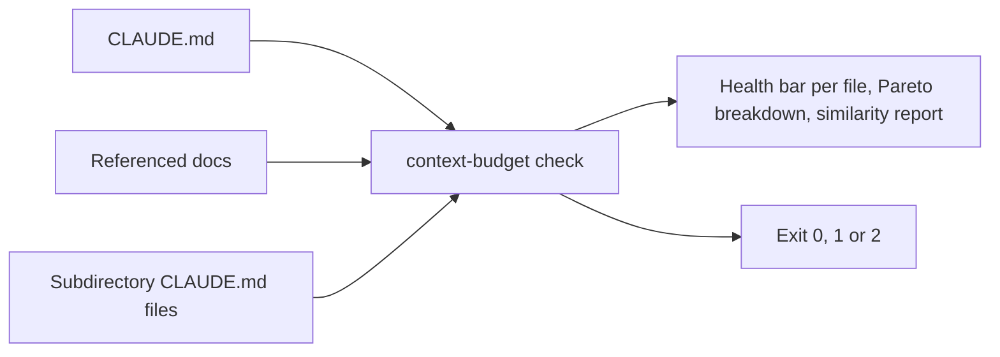

# 📏 agent-context-budget

CLAUDE.md, AGENTS.md and per-package context docs load on every agent session, so every extra token
is a recurring tax. `agent-context-budget` scores a repo's context files against configurable token
thresholds and shows where to cut.



## ⚡ Install

```sh
npm install --save-dev agent-context-budget
npx agent-context-budget check
```

It installs the `context-budget` command; `npx agent-context-budget` runs it without installing.

```text
$ npx agent-context-budget check

=== CLAUDE.md Token Budget ===

Root (always loaded):
  ✓ CLAUDE.md                     146 tokens  ░░░░░░░░░░  4%  GOOD

=== Health Summary ===
  Root:       146 / 3,500 tokens  ░░░░░░░░░░  4%  GOOD

✓ All files within budget.
```

## ⚙️ Usage

```sh
npx agent-context-budget check
npx agent-context-budget check --json
npx agent-context-budget check --explain CLAUDE.md
```

File discovery is relative to the current working directory, so run it from the directory containing
the root context file.

`check` analyzes the root context file, every file it references (matched via
`root.referencePattern`), and every `CLAUDE.md` found one level under the configured `subdir.dirs`.

```
Usage: context-budget check [options]

Options:
  --json             output machine-readable JSON instead of the human-readable report
  --explain <path>   print a detailed breakdown for a single file
```

Exit codes: `0` all files within budget, `1` a hard-failing file exceeded its threshold, `2`
advisory-only findings (noise, redundancy, orphans, dead refs, near-duplicate files) with nothing
over budget.

## 📋 Options

Reads `./agent-context-budget.config.json` if present, deep-merged over the built-in defaults, so a
partial override only needs the fields it changes:

```json
{
  "root": { "threshold": 4000 },
  "subdir": { "dirs": ["apps", "packages", "tooling"] }
}
```

| Field                     | Default                                   | Meaning                                                                   |
| ------------------------- | ----------------------------------------- | ------------------------------------------------------------------------- |
| `charsPerToken`           | `4`                                       | Reserved for future use; the calibrated estimator does not read this      |
| `root.file`               | `"CLAUDE.md"`                             | The always-loaded root context file                                       |
| `root.referencePattern`   | `` `(\\.planning/codebase/[^`]+\\.md)` `` | Regex matching on-demand reference docs linked from the root file         |
| `root.threshold`          | `3500`                                    | Token budget for the root file (hard-fails the check when exceeded)       |
| `references.threshold`    | `2000`                                    | Token budget for each referenced doc                                      |
| `references.failOnExceed` | `false`                                   | Whether exceeding a reference doc's budget is a hard failure              |
| `subdir.dirs`             | `["apps", "packages"]`                    | Top-level directories scanned one level deep for `CLAUDE.md`              |
| `subdir.threshold`        | `1500`                                    | Token budget for each subdirectory `CLAUDE.md`                            |
| `subdir.failOnExceed`     | `false`                                   | Whether exceeding a subdirectory budget is a hard failure                 |
| `health.goodBelow`        | `0.6`                                     | Ratio-of-budget below which a file is "good" (must be below normalBelow)  |
| `health.normalBelow`      | `0.85`                                    | Ratio-of-budget below which a file is "normal" (above is "warning"/"bad") |
| `planningDir`             | `".planning/codebase"`                    | Directory scanned for orphaned reference docs not linked from `root.file` |

Source: `src/config.ts`.

## 🧰 Programmatic use

```ts
import { analyzeFile, estimateTokens, findSimilarFiles, loadConfig } from "agent-context-budget";

const config = loadConfig();
const content = "# My CLAUDE.md\n...";

const tokens = estimateTokens(content);
const result = analyzeFile(content, { threshold: config.root.threshold });

const pairs = findSimilarFiles([
  { path: "a.md", content: "..." },
  { path: "b.md", content: "..." },
]);
```

## 🔁 Run it on every commit

Point a pre-commit hook at your context files so a bloated CLAUDE.md never lands. With
[Lefthook](https://github.com/evilmartians/lefthook):

```yaml
pre-commit:
  commands:
    agent-context-budget:
      glob: ["CLAUDE.md", "AGENTS.md", ".planning/codebase/*.md"]
      run: npx agent-context-budget check
```

Exit code `2` means advisory findings only; treat it as a pass if you only want to block on budgets:
`npx agent-context-budget check || [ $? -eq 2 ]`.

## 📚 Docs

- 🚀
  **[Tutorial](https://github.com/arnaud-zg/packages/blob/main/docs/agent-context-budget/tutorial.md)**:
  keep your context files under a token budget
- 🛠️
  **[How-to](https://github.com/arnaud-zg/packages/blob/main/docs/agent-context-budget/how-to.md)**:
  block a commit, explain one file, read the result in CI
- 📖
  **[Reference](https://github.com/arnaud-zg/packages/blob/main/docs/agent-context-budget/reference.md)**:
  CLI, exit codes, every config field, exports
- 💡
  **[Explanation](https://github.com/arnaud-zg/packages/blob/main/docs/agent-context-budget/explanation.md)**:
  what the score measures

## 📈 Downloads

<a href="https://npm-stat.com/charts.html?package=agent-context-budget">
  <picture>
    <source media="(prefers-color-scheme: dark)" srcset="https://shieldcn.dev/chart/npm/agent-context-budget.svg?days=90&logo=false&mode=dark" />
    
  </picture>
</a>
