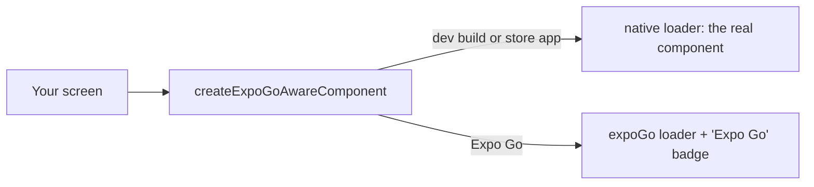
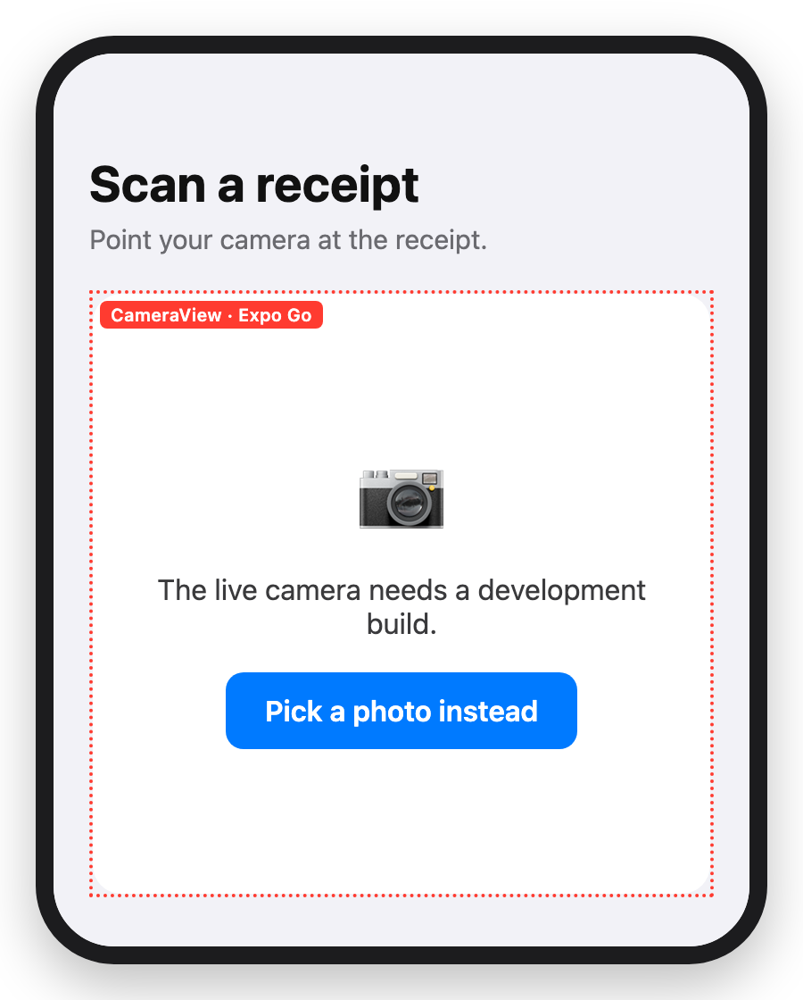

# 🛡️ expo-native-guard

Expo Go only bundles Expo's own native modules, so any package with its own native binding (Nitro
modules like `react-native-vision-camera`, TurboModules like `react-native-onesignal`, a custom Expo
module like `expo-mascot`) throws at import or resolution time. This package makes that a
controlled, visible fallback instead of a crash.



<p align="center">
  
</p>

In Expo Go, the camera screen shows its fallback with the badge. In a development build or the store
app, the real camera shows and the badge never appears.

## ⚡ Install

```bash
npm install expo-native-guard
```

```tsx
import { createExpoGoAwareComponent } from "expo-native-guard";

export const CameraView = createExpoGoAwareComponent("CameraView", {
  native: () => require("./CameraView").CameraView,
  expoGo: () => require("./CameraView.expoGo").CameraView,
});
```

Both loaders are lazy: pass a `require()` call, not a static `import`. Bundlers evaluate top-level
imports eagerly, so a static import of the native variant would crash Expo Go before the check ran.
The `expoGo` result is wrapped with `withExpoGoIndicator` using the given name.

## 🩹 Fixes these errors

```text
Error: Cannot find native module 'MyNativeModule'
```

```text
Invariant Violation: TurboModuleRegistry.getEnforcing(...): 'RNMyModule' could not be found.
```

## ⚙️ Usage

`loadExpoGoAwareModule` is the lower-level primitive `createExpoGoAwareComponent` is built on. It
picks between two loaders for any value, not just a component:

```ts
export const CameraView = loadExpoGoAwareModule({
  native: () => require("./CameraView").CameraView,
  expoGo: () => require("./CameraView.expoGo").CameraView,
});
```

`resolveUnlessExpoGo` is for a single native lookup (`requireNativeModule`/`requireNativeView`)
rather than two full implementations. It returns `null` in Expo Go instead of throwing, so the
caller can fall back to a plain JS/RN implementation:

```ts
const NativeView = resolveUnlessExpoGo(() => requireNativeView<Props>("MyNativeView"));

export default function MyView(props: Props) {
  const View = NativeView ?? MyFallbackView;
  return <View {...props} />;
}
```

`withExpoGoIndicator` adds a dotted red border and a `<name> · Expo Go` badge to a fallback. Use it
directly only when composing `loadExpoGoAwareModule` by hand:

```tsx
expoGo: () => withExpoGoIndicator(require("./CameraView.expoGo").CameraView, "CameraView"),
```

## 📋 Exports

| Export                       | `expo-native-guard` | `expo-native-guard/core` |
| ---------------------------- | ------------------- | ------------------------ |
| `createExpoGoAwareComponent` | yes                 | no                       |
| `loadExpoGoAwareModule`      | yes                 | yes                      |
| `resolveUnlessExpoGo`        | yes                 | yes                      |
| `withExpoGoIndicator`        | yes                 | no                       |

`expo-native-guard/core` has no React or `react-native` import. `expo`, `react` and `react-native`
are peer dependencies: `expo >=50.0.0`, `react-native >=0.73.0`.

Source: `src/index.ts`, `src/core.ts`.

## 📚 Docs

- 🚀
  **[Tutorial](https://github.com/arnaud-zg/packages/blob/main/docs/expo-native-guard/tutorial.md)**:
  stop a native-only import from crashing Expo Go
- 🛠️ **[How-to](https://github.com/arnaud-zg/packages/blob/main/docs/expo-native-guard/how-to.md)**:
  guard a component, guard a single native lookup, use the logic without React
- 📖
  **[Reference](https://github.com/arnaud-zg/packages/blob/main/docs/expo-native-guard/reference.md)**:
  every export and its signature, peer dependency ranges
- 💡
  **[Explanation](https://github.com/arnaud-zg/packages/blob/main/docs/expo-native-guard/explanation.md)**:
  why `require()` loaders, why the badge, why the implementation layer stays thin

## 📈 Downloads

<a href="https://npm-stat.com/charts.html?package=expo-native-guard">
  <picture>
    <source media="(prefers-color-scheme: dark)" srcset="https://shieldcn.dev/chart/npm/expo-native-guard.svg?days=90&logo=false&mode=dark" />
    
  </picture>
</a>
