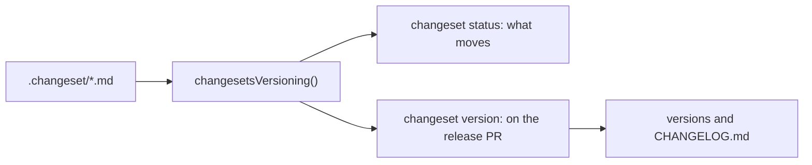

# 🔌 @shiplane/changesets

Versions from `.changeset` files, through the changesets CLI: fills
[shiplane](../shiplane/README.md)'s **versioning** port. A changeset is the intent to release;
shiplane turns the pending ones into versions and changelogs on the release PR.



## Install

```sh
pnpm add -D shiplane @shiplane/changesets @changesets/cli
```

## Configure

Give the adapter to `releaseFlow`. From
[`examples/shiplane.config.ts`](./examples/shiplane.config.ts):

```ts
import { changesetsVersioning } from "@shiplane/changesets";
import { gitSourceControl } from "@shiplane/git";
import { gitHubActionsCiPipeline, gitHubCodeHost } from "@shiplane/github";
import { defineRelease, internalTool, releaseFlow } from "shiplane";

export default defineRelease({
  flow: releaseFlow({
    sourceControl: gitSourceControl(),
    codeHost: gitHubCodeHost(),
    ciPipeline: gitHubActionsCiPipeline(),
    // The root script versions, then refreshes the lockfile.
    versioning: changesetsVersioning({ version: ["pnpm", "-s", "changeset:version"] }),
  }),
  modules: [internalTool()],
});
```

## Options

It fills a flow port, so unit files take no key from it. Its factory takes:

| Option    | Default                                    | Means                                 |
| --------- | ------------------------------------------ | ------------------------------------- |
| `version` | `["pnpm", "exec", "changeset", "version"]` | The command that versions the release |

Source: `ChangesetsOptions` in `src/changesets-versioning.adapter.ts`.

## Example

[`examples/`](./examples) holds one pending changeset,
[`.changeset/quiet-seeds-wait.md`](./examples/.changeset/quiet-seeds-wait.md):

```md
---
"@acme/scripts": patch
---

The seed script skips rows it already wrote.
```

`pnpm shiplane status` in that repository counts it:

```text
  Release status  ·  preview

  Unit      Version     Target            Where it stands
  scripts   1.0.0       release-only      ↑ 1 changeset

→ Next: open the release PR: shiplane
```

What moves is read with `changeset status`, which writes nothing. Changesets held back for a later
release are set aside only while it versions. A GitHub changelog asks GitHub who wrote each change:
`GITHUB_TOKEN` when set, your `gh` sign-in otherwise.

## Tools and sign-ins

| Tool                               | Needed for                                       |
| ---------------------------------- | ------------------------------------------------ |
| `@changesets/cli` in the workspace | `changeset status` and `changeset version`       |
| `gh`, signed in                    | A GitHub changelog, when `GITHUB_TOKEN` is unset |

The adapter declares no `requirements`, so `doctor` checks neither. Source:
`src/changesets-versioning.adapter.ts`.
