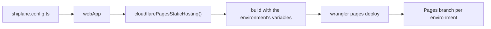

# 🔌 @shiplane/cloudflare-pages

Ships a static site to Cloudflare Pages: fills [shiplane](../shiplane/README.md)'s **static
hosting** port. Each release builds against its environment, then uploads with wrangler.



## Install

```sh
pnpm add -D shiplane @shiplane/cloudflare-pages
```

## Configure

Give the adapter to `webApp`. From [`examples/shiplane.config.ts`](./examples/shiplane.config.ts):

```ts
import { changesetsVersioning } from "@shiplane/changesets";
import { cloudflarePagesStaticHosting } from "@shiplane/cloudflare-pages";
import { gitSourceControl } from "@shiplane/git";
import { gitHubActionsCiPipeline, gitHubCodeHost } from "@shiplane/github";
import { defineRelease, releaseFlow, webApp } from "shiplane";

export default defineRelease({
  flow: releaseFlow({
    sourceControl: gitSourceControl(),
    codeHost: gitHubCodeHost(),
    ciPipeline: gitHubActionsCiPipeline(),
    versioning: changesetsVersioning(),
  }),
  modules: [webApp({ staticHosting: cloudflarePagesStaticHosting() })],
});
```

## Unit file keys

In the app's `shiplane.unit.yml`, next to `module: web-app`.

| Key             | Default                                   | Means                                                        |
| --------------- | ----------------------------------------- | ------------------------------------------------------------ |
| `project`       | required                                  | The Cloudflare Pages project                                 |
| `dist`          | `dist`                                    | What the build writes, relative to the unit's folder         |
| `build.command` | `pnpm turbo run build --filter=<package>` | The build, run from the root, as a list                      |
| `build.env`     |                                           | Variables the build reads, each per environment              |
| `branch`        | `preview` / `main`                        | The Pages branch; production is the project's production one |
| `wrangler`      | `wrangler@4.141.0`                        | The wrangler npx runs, pinned                                |

Source: `PagesOptions` in `src/cloudflare-pages-static-hosting.adapter.ts`.

## Example

From [`examples/apps/site/shiplane.unit.yml`](./examples/apps/site/shiplane.unit.yml):

```yaml
module: web-app
project: acme-site
build:
  env:
    PUBLIC_API_URL:
      preview: https://api-preview.acme.dev
      production: https://api.acme.dev
```

`pnpm shiplane plan` in that repository prints what a ship to preview would run:

```text
  Plan  ·  preview  · nothing runs
  Order  1 site · Latest

  site@1.0.0 → acme-site on Pages (preview)  (not tagged yet: release first)
    this machine
      PUBLIC_API_URL=https://api-preview.acme.dev pnpm turbo run build --filter=@acme/site
      npx --yes wrangler@4.141.0 pages deploy apps/site/dist --project-name=acme-site --branch=preview --commit-hash=3954c619a8fbede510f2b826fe5aaea9b3704815 --commit-message=site@1.0.0
      then record site@1.0.0 on preview in GitHub Deployments
    GitHub Actions
      gh workflow run ship.yml --ref site@1.0.0 -f units=site -f environment=preview
```

The upload is the deploy: it returns in seconds. `init` offers this adapter for a folder with a
`wrangler.toml` or `wrangler.json(c)`, and for an Astro, Next, Nuxt, Svelte or Vite site.

## Tools and sign-ins

| Tool       | Checked with                        | Fixed with                         | In CI                  |
| ---------- | ----------------------------------- | ---------------------------------- | ---------------------- |
| `wrangler` | `npx --yes wrangler@4.141.0 whoami` | `npx --yes wrangler@4.141.0 login` | `CLOUDFLARE_API_TOKEN` |

Source: `requirements` in `src/cloudflare-pages-static-hosting.adapter.ts`; the version follows
`wrangler`. `pnpm shiplane doctor` runs each check and offers the fix.

## 📈 Downloads

<a href="https://npm-stat.com/charts.html?package=@shiplane/cloudflare-pages">
  <picture>
    <source media="(prefers-color-scheme: dark)" srcset="https://shieldcn.dev/chart/npm/@shiplane/cloudflare-pages.svg?days=90&logo=false&mode=dark" />
    
  </picture>
</a>
