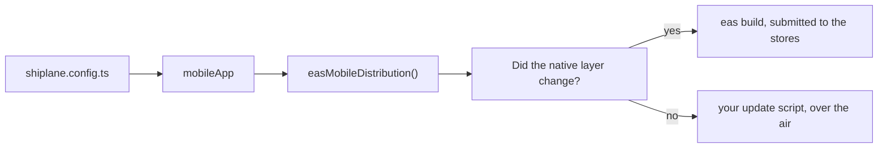

# 🔌 @shiplane/eas

Ships an Expo app with EAS: fills
[shiplane](https://github.com/arnaud-zg/packages/blob/main/packages/shiplane/README.md)'s **mobile
distribution** port. Each release is a store build or an over-the-air update, picked from the native
fingerprint.



## ⚡ Install

```sh
pnpm add -D shiplane @shiplane/eas
```

## ⚙️ Configure

Give the adapter to `mobileApp`. From
[`examples/shiplane.config.ts`](./examples/shiplane.config.ts):

```ts
import { changesetsVersioning } from "@shiplane/changesets";
import { easMobileDistribution } from "@shiplane/eas";
import { gitSourceControl } from "@shiplane/git";
import { gitHubActionsCiPipeline, gitHubCodeHost } from "@shiplane/github";
import { defineRelease, mobileApp, releaseFlow } from "shiplane";

export default defineRelease({
  flow: releaseFlow({
    sourceControl: gitSourceControl(),
    codeHost: gitHubCodeHost(),
    ciPipeline: gitHubActionsCiPipeline(),
    versioning: changesetsVersioning(),
  }),
  modules: [mobileApp({ mobileDistribution: easMobileDistribution() })],
});
```

## 📋 Unit file keys

In the app's `shiplane.unit.yml`, next to `module: mobile-app`.

| Key           | Default            | Means                                                        |
| ------------- | ------------------ | ------------------------------------------------------------ |
| `update`      | required           | The package script that publishes an update, per environment |
| `versionFile` | `app-version.json` | Each environment's binary version                            |

Source: `EasOptions` in `src/eas-mobile-distribution.adapter.ts`.

## 🧪 Example

From [`examples/apps/mobile/shiplane.unit.yml`](./examples/apps/mobile/shiplane.unit.yml):

```yaml
module: mobile-app
update:
  preview: eas:update:preview
  production: eas:update:production
```

`pnpm shiplane plan` in that repository prints both ways a ship to preview could go:

```text
  Plan  ·  preview  · nothing runs
  Order  1 mobile · Latest

  mobile@1.0.0 → EAS preview, iOS and Android  (not tagged yet: release first)
    this machine
      EXPO_ATLAS=false APP_VARIANT=preview pnpm exec eas build --profile preview --platform all --auto-submit --no-wait
    this machine
      APP_VARIANT=preview pnpm run eas:update:preview
    GitHub Actions
      gh workflow run ship.yml --ref mobile@1.0.0 -f units=mobile -f environment=preview
```

At release time EAS decides: a build when the fingerprint moved, an update when it did not. Builds
run from this machine and return at once (`--no-wait`). An update script with `--rollout-percentage`
starts a staged rollout that `shiplane promote` widens. `init` offers this adapter for a folder with
an `eas.json`.

## 🔑 Tools and sign-ins

| Tool  | Checked with                       | Fixed with                        | In CI        |
| ----- | ---------------------------------- | --------------------------------- | ------------ |
| `eas` | `pnpm exec eas whoami`, in the app | `pnpm exec eas login`, in the app | `EXPO_TOKEN` |

Source: `requirements` in `src/eas-mobile-distribution.adapter.ts`. `pnpm shiplane doctor` runs each
check and offers the fix.

## 📚 Docs

- 🔌 **[Plugins](https://github.com/arnaud-zg/packages/blob/main/docs/shiplane/plugins.md)**: how
  shiplane plugins work, and how to write one
- 🚢 **[shiplane](https://github.com/arnaud-zg/packages/blob/main/packages/shiplane/README.md)**:
  the release tool this plugin fills a port of
- 🛠️ **[How-to](https://github.com/arnaud-zg/packages/blob/main/docs/shiplane/how-to.md)**: add an
  app, promote, ship from CI
- 📖 **[Reference](https://github.com/arnaud-zg/packages/blob/main/docs/shiplane/reference.md)**:
  commands, flags, the config and unit files

## 📈 Downloads

<a href="https://npm-stat.com/charts.html?package=@shiplane/eas">
  <picture>
    <source media="(prefers-color-scheme: dark)" srcset="https://shieldcn.dev/chart/npm/@shiplane/eas.svg?days=90&logo=false&mode=dark" />
    
  </picture>
</a>
