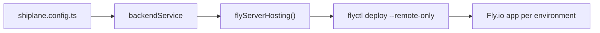

# 🔌 @shiplane/fly

Ships a backend to Fly.io: fills
[shiplane](https://github.com/arnaud-zg/packages/blob/main/packages/shiplane/README.md)'s **server
hosting** port with `flyctl deploy`. Any app with a Dockerfile works.



## ⚡ Install

```sh
pnpm add -D shiplane @shiplane/fly
```

## ⚙️ Configure

Give the adapter to `backendService`. From
[`examples/shiplane.config.ts`](./examples/shiplane.config.ts):

```ts
import { changesetsVersioning } from "@shiplane/changesets";
import { flyServerHosting } from "@shiplane/fly";
import { gitSourceControl } from "@shiplane/git";
import { gitHubActionsCiPipeline, gitHubCodeHost } from "@shiplane/github";
import { backendService, defineRelease, releaseFlow } from "shiplane";

export default defineRelease({
  flow: releaseFlow({
    sourceControl: gitSourceControl(),
    codeHost: gitHubCodeHost(),
    ciPipeline: gitHubActionsCiPipeline(),
    versioning: changesetsVersioning(),
  }),
  modules: [backendService({ serverHosting: flyServerHosting() })],
});
```

## 📋 Unit file keys

In the app's `shiplane.unit.yml`, next to `module: backend-service`. A key marked per environment
also takes a `preview:` / `production:` map.

| Key            | Default      | Means                                                                    |
| -------------- | ------------ | ------------------------------------------------------------------------ |
| `app`          | required     | The Fly app, per environment                                             |
| `config`       | `fly.toml`   | Its fly.toml, relative to the unit's folder, per environment             |
| `dockerfile`   | `Dockerfile` | Relative to the unit's folder; the image builds from the repository root |
| `url`          |              | Where it answers, for other units to read, per environment               |
| `buildSecrets` | `[]`         | Variables its image build reads as secrets, passed by name when set      |

Source: `FlyOptions` in `src/fly-server-hosting.adapter.ts`. `shiplane docs fly` prints the same.

## 🧪 Example

From [`examples/apps/api/shiplane.unit.yml`](./examples/apps/api/shiplane.unit.yml):

```yaml
module: backend-service
app:
  preview: acme-api-preview
  production: acme-api
config:
  preview: fly-preview.toml
  production: fly-production.toml
url:
  preview: https://api-preview.acme.dev
  production: https://api.acme.dev
```

`pnpm shiplane plan` in that repository prints what a ship to preview would run:

```text
  Plan  ·  preview  · nothing runs
  Order  1 api · Latest

  api@1.0.0 → acme-api-preview (Fly)  (not tagged yet: release first)
    this machine
      flyctl deploy --remote-only --config apps/api/fly-preview.toml --dockerfile apps/api/Dockerfile
      then record api@1.0.0 on preview in GitHub Deployments
    GitHub Actions
      gh workflow run ship.yml --ref api@1.0.0 -f units=api -f environment=preview
```

The deploy waits until Fly rolled it out, then records it. `init` offers this adapter for a folder
with a `fly.toml` (or `fly-preview.toml` and `fly-production.toml`), and as a possibility for a
folder with only a Dockerfile.

## 🔑 Tools and sign-ins

| Tool     | Checked with         | Fixed with          | In CI           |
| -------- | -------------------- | ------------------- | --------------- |
| `flyctl` | `flyctl auth whoami` | `flyctl auth login` | `FLY_API_TOKEN` |

Source: `requirements` in `src/fly-server-hosting.adapter.ts`. `pnpm shiplane doctor` runs each
check and offers the fix.

## 📚 Docs

- 🔌 **[Plugins](https://github.com/arnaud-zg/packages/blob/main/docs/shiplane/plugins.md)**: how
  shiplane plugins work, and how to write one
- 🚢 **[shiplane](https://github.com/arnaud-zg/packages/blob/main/packages/shiplane/README.md)**:
  the release tool this plugin fills a port of
- 🛠️ **[How-to](https://github.com/arnaud-zg/packages/blob/main/docs/shiplane/how-to.md)**: add an
  app, promote, ship from CI
- 📖 **[Reference](https://github.com/arnaud-zg/packages/blob/main/docs/shiplane/reference.md)**:
  commands, flags, the config and unit files

## 📈 Downloads

<a href="https://npm-stat.com/charts.html?package=@shiplane/fly">
  <picture>
    <source media="(prefers-color-scheme: dark)" srcset="https://shieldcn.dev/chart/npm/@shiplane/fly.svg?days=90&logo=false&mode=dark" />
    
  </picture>
</a>
