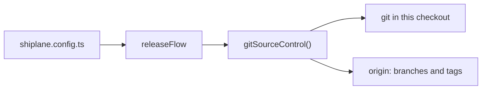

# 🔌 @shiplane/git

Reads and writes the repository through the git CLI: fills [shiplane](../shiplane/README.md)'s
**source control** port. Versions, tags, the release branch and every push go through it.



📚
[How shiplane plugins work](https://github.com/arnaud-zg/packages/blob/main/docs/shiplane/plugins.md).

## Install

```sh
pnpm add -D shiplane @shiplane/git
```

## Configure

Give the adapter to `releaseFlow`. From
[`examples/shiplane.config.ts`](./examples/shiplane.config.ts):

```ts
import { changesetsVersioning } from "@shiplane/changesets";
import { gitSourceControl } from "@shiplane/git";
import { gitHubActionsCiPipeline, gitHubCodeHost } from "@shiplane/github";
import { defineRelease, internalTool, releaseFlow } from "shiplane";

export default defineRelease({
  flow: releaseFlow({
    // Releases start from trunk; the release commit is formatted like any other.
    sourceControl: gitSourceControl({
      main: "trunk",
      format: ["pnpm", "exec", "prettier", "--write", "--ignore-unknown"],
    }),
    codeHost: gitHubCodeHost(),
    ciPipeline: gitHubActionsCiPipeline(),
    versioning: changesetsVersioning(),
  }),
  modules: [internalTool()],
});
```

## Options

It fills a flow port, so unit files take no key from it. Its factory takes:

| Option        | Default           | Means                                                         |
| ------------- | ----------------- | ------------------------------------------------------------- |
| `main`        | `main`            | The branch releases start from                                |
| `format`      |                   | A command run on a commit's files before it is made           |
| `retryDelays` | `[2_000, 10_000]` | Waits in ms before each new try of a push the network dropped |

Source: `GitOptions` in `src/git-source-control.adapter.ts`.

## Example

`pnpm shiplane status` in [`examples/`](./examples), on `trunk`, with its one tool never tagged:

```text
  Release status  ·  live

  Unit      Version     Target            Where it stands
  scripts   1.0.0       release-only      ↑ 1.0.0 first release
  Untagged  scripts@1.0.0

→ Next: tag what was versioned and ship it: shiplane
```

Pushes skip the pre-push hooks (what a release pushes, main already checked) and retry when the
connection drops, never when it is refused. A tag is signed when your commits are
(`commit.gpgsign`), annotated otherwise. Offline, the last fetched `origin` still answers.

## Tools and sign-ins

| Tool  | Checked with    |
| ----- | --------------- |
| `git` | `git --version` |

Source: `requirements` in `src/git-source-control.adapter.ts`; no fix is offered. Pushing needs your
own rights on `origin`.

## 📈 Downloads

<a href="https://npm-stat.com/charts.html?package=@shiplane/git">
  <picture>
    <source media="(prefers-color-scheme: dark)" srcset="https://shieldcn.dev/chart/npm/@shiplane/git.svg?days=90&logo=false&mode=dark" />
    
  </picture>
</a>
