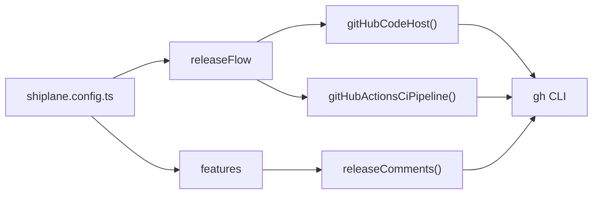

# 🔌 @shiplane/github

GitHub for [shiplane](https://github.com/arnaud-zg/packages/blob/main/packages/shiplane/README.md),
through the `gh` CLI. Two adapters and a feature, one sign-in:

| Factory                     | Fills            | Does                                                         |
| --------------------------- | ---------------- | ------------------------------------------------------------ |
| `gitHubCodeHost()`          | Code host port   | The release PR, release notes, deploy records, comments      |
| `gitHubActionsCiPipeline()` | CI pipeline port | Dispatches the ship workflow, reads runs and Actions minutes |
| `releaseComments()`         | A feature        | Tells each shipped PR, and each issue it relates to          |



## ⚡ Install

```sh
pnpm add -D shiplane @shiplane/github
```

## ⚙️ Configure

From [`examples/shiplane.config.ts`](./examples/shiplane.config.ts):

```ts
import { changesetsVersioning } from "@shiplane/changesets";
import { gitSourceControl } from "@shiplane/git";
import { gitHubActionsCiPipeline, gitHubCodeHost, releaseComments } from "@shiplane/github";
import { backendService, defineRelease, releaseFlow, shellServerHosting } from "shiplane";

const sourceControl = gitSourceControl();
const codeHost = gitHubCodeHost();

export default defineRelease({
  flow: releaseFlow({
    sourceControl,
    codeHost,
    // A ship through GitHub Actions dispatches deploy.yml with `units` and `environment`.
    ciPipeline: gitHubActionsCiPipeline({ shipWorkflow: "deploy.yml" }),
    versioning: changesetsVersioning(),
  }),
  modules: [backendService({ serverHosting: shellServerHosting() })],
  // After a ship, each PR in the version and each issue it relates to hears about it.
  features: [releaseComments({ codeHost, sourceControl })],
});
```

## 📋 Options

It fills flow ports, so unit files take no key from it. The factories take:

| Factory                     | Option          | Default    | Means                                                           |
| --------------------------- | --------------- | ---------- | --------------------------------------------------------------- |
| `gitHubCodeHost()`          |                 |            | No option                                                       |
| `gitHubActionsCiPipeline()` | `shipWorkflow`  | `ship.yml` | The workflow a ship dispatches, given `units` and `environment` |
| `releaseComments()`         | `codeHost`      | required   | Where the PRs and issues live, and the comments go              |
| `releaseComments()`         | `sourceControl` | required   | Where the tags are, to find the version a ship follows          |
| `releaseComments()`         | `apps`          | every app  | The apps whose ships comment                                    |

Source: `src/github-code-host.adapter.ts`, `src/github-actions-ci-pipeline.adapter.ts`,
`ReleaseCommentsOptions` in `src/release-comments.feature.ts`.

## 🧪 Example

`pnpm shiplane plan` in [`examples/`](./examples/shiplane.config.ts) shows the ship through GitHub
Actions dispatching `deploy.yml`:

```text
  Plan  ·  preview  · nothing runs
  Order  1 api · Latest

  api@1.0.0 → ./deploy.sh  (not tagged yet: release first)
    this machine
      ./deploy.sh
      then record api@1.0.0 on preview in GitHub Deployments
    GitHub Actions
      gh workflow run deploy.yml --ref api@1.0.0 -f units=api -f environment=preview
```

On the runner, the workflow runs `shiplane ship` with the same unit files. Each comment carries a
marker, so a version tells a PR once per environment, however many times it ships.

## 🔑 Tools and sign-ins

| Tool | Checked with     | Fixed with      | In CI      |
| ---- | ---------------- | --------------- | ---------- |
| `gh` | `gh auth status` | `gh auth login` | `GH_TOKEN` |

Source: `requirements` in both adapters. `pnpm shiplane doctor` runs the check and offers the fix.

## 📚 Docs

- 🔌 **[Plugins](https://github.com/arnaud-zg/packages/blob/main/docs/shiplane/plugins.md)**: how
  shiplane plugins work, and how to write one
- 🚢 **[shiplane](https://github.com/arnaud-zg/packages/blob/main/packages/shiplane/README.md)**:
  the release tool this plugin fills a port of
- 🛠️ **[How-to](https://github.com/arnaud-zg/packages/blob/main/docs/shiplane/how-to.md)**: add an
  app, promote, ship from CI
- 📖 **[Reference](https://github.com/arnaud-zg/packages/blob/main/docs/shiplane/reference.md)**:
  commands, flags, the config and unit files

## 📈 Downloads

<a href="https://npm-stat.com/charts.html?package=@shiplane/github">
  <picture>
    <source media="(prefers-color-scheme: dark)" srcset="https://shieldcn.dev/chart/npm/@shiplane/github.svg?days=90&logo=false&mode=dark" />
    
  </picture>
</a>
