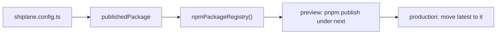

# 🔌 @shiplane/npm

Publishes a package to npm: fills [shiplane](../shiplane/README.md)'s **package registry** port with
`pnpm publish` and `npm dist-tag`.



## Install

```sh
pnpm add -D shiplane @shiplane/npm
```

## Configure

Give the adapter to `publishedPackage`. From
[`examples/shiplane.config.ts`](./examples/shiplane.config.ts):

```ts
import { changesetsVersioning } from "@shiplane/changesets";
import { gitSourceControl } from "@shiplane/git";
import { gitHubActionsCiPipeline, gitHubCodeHost } from "@shiplane/github";
import { npmPackageRegistry } from "@shiplane/npm";
import { defineRelease, publishedPackage, releaseFlow } from "shiplane";

export default defineRelease({
  flow: releaseFlow({
    sourceControl: gitSourceControl(),
    codeHost: gitHubCodeHost(),
    ciPipeline: gitHubActionsCiPipeline(),
    versioning: changesetsVersioning(),
  }),
  modules: [publishedPackage({ packageRegistry: npmPackageRegistry() })],
});
```

## Unit file keys

In the package's `shiplane.unit.yml`, next to `module: published-package`.

| Key         | Default  | Means                                                                                  |
| ----------- | -------- | -------------------------------------------------------------------------------------- |
| `tag`       | `latest` | The dist-tag each environment moves; `{ preview: next, production: latest }` stages it |
| `access`    | `public` | Who can install it: `public` or `restricted`                                           |
| `publishAs` |          | The name it publishes under, when its workspace name is not a valid npm name           |

Source: `NpmOptions` in `src/npm-package-registry.adapter.ts`.

## Example

From [`examples/packages/toolkit/shiplane.unit.yml`](./examples/packages/toolkit/shiplane.unit.yml):

```yaml
module: published-package
tag:
  preview: next
  production: latest
```

`pnpm shiplane plan` in that repository prints what a ship to preview could run:

```text
  Plan  ·  preview  · nothing runs
  Order  1 toolkit · Latest

  toolkit@1.0.0 → @acme/toolkit on npm (next)  (not tagged yet: release first)
    this machine
      pnpm publish --no-git-checks --access public --tag next
    this machine
      npm dist-tag add @acme/toolkit@1.0.0 next
```

A ship asks npm first: a version not published yet is published, one already out only has its tag
moved, so nothing publishes twice. It publishes this checkout, so it stops when main moved past the
tag; production waits for a version preview published. `init` offers this adapter for a public
package with a `bin`, `exports` or `main`.

## Tools and sign-ins

| Tool  | Checked with | Fixed with  | In CI                                |
| ----- | ------------ | ----------- | ------------------------------------ |
| `npm` | `npm whoami` | `npm login` | none: it publishes from this machine |

Source: `requirements` in `src/npm-package-registry.adapter.ts`. `pnpm shiplane doctor` runs each
check and offers the fix.
