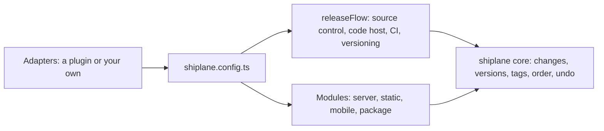

# 🚢 shiplane

The release core: it finds what changed, versions it, tags it and ships each app in order. It talks
to no host itself. You inject one adapter per port in `shiplane.config.ts`.



## ⚡ Three commands

```sh
pnpm shiplane init       # find what ships, write the config
pnpm shiplane            # release PR, merge, tags, ship to preview
pnpm shiplane promote    # what preview validated, to production
```

## 🔌 Ports

The core only knows these interfaces. Each one is filled by the adapter you give it.

| Port                | What it does                                   | Filled by                        |
| ------------------- | ---------------------------------------------- | -------------------------------- |
| Source control      | The history: tags, commits, branches, push     | `releaseFlow({ sourceControl })` |
| Code host           | Pull requests, release notes, deploy records   | `releaseFlow({ codeHost })`      |
| CI pipeline         | Dispatches the ship workflow, reads its runs   | `releaseFlow({ ciPipeline })`    |
| Versioning          | Pending changes, the next versions, changelogs | `releaseFlow({ versioning })`    |
| Server hosting      | Runs a service from a tag                      | `backendService(...)`            |
| Static hosting      | Serves a static build per environment          | `webApp(...)`                    |
| Mobile distribution | Ships a store build or an over-the-air update  | `mobileApp(...)`                 |
| Package registry    | Publishes a package, moves its dist-tag        | `publishedPackage(...)`          |

Source: `src/ports/*.port.ts`.

## 🧩 Modules

A module is a kind of app. Each app's `shiplane.unit.yml` names its module.

| Module                                  | `module:`           | Takes                                          |
| --------------------------------------- | ------------------- | ---------------------------------------------- |
| `backendService({ serverHosting })`     | `backend-service`   | Server hosting                                 |
| `webApp({ staticHosting })`             | `web-app`           | Static hosting                                 |
| `mobileApp({ mobileDistribution })`     | `mobile-app`        | Mobile distribution                            |
| `publishedPackage({ packageRegistry })` | `published-package` | Package registry                               |
| `agentPlugin()`                         | `agent-plugin`      | Nothing: tagged, its agent manifests versioned |
| `internalTool()`                        | `internal-tool`     | Nothing: tagged only                           |

Source: `src/modules/`.

## 💉 Inject the adapters

From [`examples/repository/shiplane.config.ts`](./examples/repository/shiplane.config.ts):

```ts
// Each port gets an adapter; a module per kind of app takes the adapter that ships it.
import { changesetsVersioning } from "@shiplane/changesets";
import { cloudflarePagesStaticHosting } from "@shiplane/cloudflare-pages";
import { easMobileDistribution } from "@shiplane/eas";
import { flyServerHosting } from "@shiplane/fly";
import { gitSourceControl } from "@shiplane/git";
import { gitHubActionsCiPipeline, gitHubCodeHost } from "@shiplane/github";
import { npmPackageRegistry } from "@shiplane/npm";
import {
  backendService,
  defineRelease,
  internalTool,
  mobileApp,
  publishedPackage,
  releaseFlow,
  webApp,
} from "shiplane";

export default defineRelease({
  flow: releaseFlow({
    sourceControl: gitSourceControl(),
    codeHost: gitHubCodeHost(),
    ciPipeline: gitHubActionsCiPipeline(),
    versioning: changesetsVersioning(),
  }),
  modules: [
    backendService({ serverHosting: flyServerHosting() }),
    webApp({ staticHosting: cloudflarePagesStaticHosting() }),
    mobileApp({ mobileDistribution: easMobileDistribution() }),
    publishedPackage({ packageRegistry: npmPackageRegistry() }),
    internalTool(),
  ],
});
```

`pnpm shiplane plugins` in that repository shows what got injected where:

```text
Flow in shiplane.config.ts

  sourceControl      git
  codeHost           github
  ciPipeline         github-actions
  versioning         changesets

Modules, in release order

  backend-service    fly  app, config, dockerfile, url, buildSecrets
                     used by api
  web-app            cloudflare-pages  project, dist, build, branch, wrangler
                     used by site
  mobile-app         eas  versionFile, update
                     used by mobile
  published-package  npm  publishAs, access, tag
                     used by toolkit
  internal-tool      release-only  no options
                     used by cli

Features, after the ship

  none
```

The adapters come from separate packages:
**[the adapters you can inject](../../docs/shiplane/plugins.md)**. The core carries one,
`shellServerHosting()`, for a host with no adapter yet.

## 📚 Docs

- 🚀 **[Tutorial](../../docs/shiplane/tutorial.md)**: release your first package
- 🛠️ **[How-to](../../docs/shiplane/how-to.md)**: add an app, promote, ship from CI, write a plugin
- 📖 **[Reference](../../docs/shiplane/reference.md)**: commands, flags, the config and unit files
- 🔌 **[Plugins](../../docs/shiplane/plugins.md)**: the adapters you can inject, and how to write
  one
- 💡 **[Explanation](../../docs/shiplane/explanation.md)**: why it works this way

## 📈 Downloads

<a href="https://npm-stat.com/charts.html?package=shiplane">
  <picture>
    <source media="(prefers-color-scheme: dark)" srcset="https://shieldcn.dev/chart/npm/shiplane.svg?days=90&logo=false&mode=dark" />
    
  </picture>
</a>
