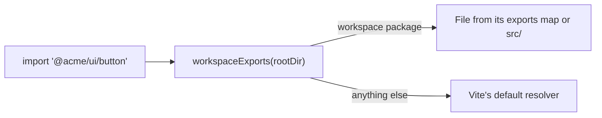

# 🧭 vite-workspace-resolver

Vite's test resolver won't follow a workspace package's `exports` map for non-`"."` subpaths, and
can't reach into a package's `src/` for files that aren't exported at all.
`workspaceExports(rootDir)` scans every workspace package once and resolves both cases as a Vite
plugin, so you stop hand-rolling `resolve.alias` entries per package and subpath.



## ⚡ Install

```sh
npm install --save-dev vite-workspace-resolver
```

```ts
import path from "node:path";
import { workspaceExports } from "vite-workspace-resolver";
import { defineConfig } from "vitest/config";

export default defineConfig({
  plugins: [workspaceExports(path.resolve(__dirname, "../.."))],
});
```

## 🩹 Fixes these errors

```text
Failed to resolve import "@acme/ui/button" from "src/app.test.ts". Does the file exist?
```

```text
Missing "./button" specifier in "@acme/ui" package
```

## ⚙️ Usage

From a test, any of these resolve to the right file in the workspace:

```ts
import { core } from "@acme/sse/core"; // exports["./core"]
import { config } from "@acme/theme/src/config"; // deep src/ import, probes .ts/.tsx
import { tokens } from "@acme/tokens"; // exports["."]
```

Every directory with a named `package.json` under one of the groups is a workspace package, whatever
its scope. Specifiers that don't name one (`react`, relative paths) return `null` and fall through
to Vite's default resolver.

## 📋 Options

`workspaceExports(rootDir, options?)`:

| Option   | Type       | Default        | Description                                                    |
| -------- | ---------- | -------------- | -------------------------------------------------------------- |
| `groups` | `string[]` | `["packages"]` | Directories under `rootDir` whose direct children are packages |

```ts
workspaceExports(root, { groups: ["packages", "tooling", "apps"] });
```

Source: `src/workspaceExports.ts`.

## 📚 Docs

- 🚀
  **[Tutorial](https://github.com/arnaud-zg/packages/blob/main/docs/vite-workspace-resolver/tutorial.md)**:
  resolve workspace imports in Vitest
- 🛠️
  **[How-to](https://github.com/arnaud-zg/packages/blob/main/docs/vite-workspace-resolver/how-to.md)**:
  resolve packages outside `packages/`
- 📖
  **[Reference](https://github.com/arnaud-zg/packages/blob/main/docs/vite-workspace-resolver/reference.md)**:
  `workspaceExports` and its options
- 💡
  **[Explanation](https://github.com/arnaud-zg/packages/blob/main/docs/vite-workspace-resolver/explanation.md)**:
  why `resolve.exports`, deep `src/` imports, a built package

## 📈 Downloads

<a href="https://npm-stat.com/charts.html?package=vite-workspace-resolver">
  <picture>
    <source media="(prefers-color-scheme: dark)" srcset="https://shieldcn.dev/chart/npm/vite-workspace-resolver.svg?days=90&logo=false&mode=dark" />
    
  </picture>
</a>
